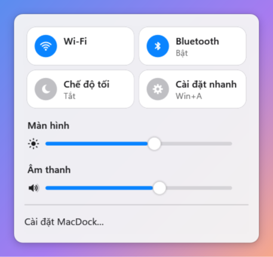
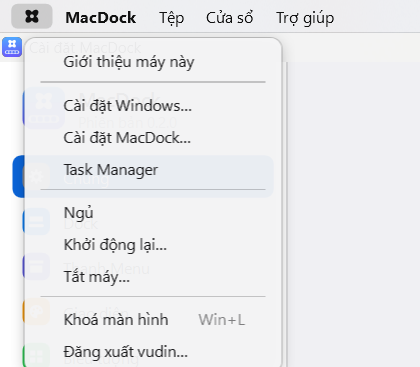
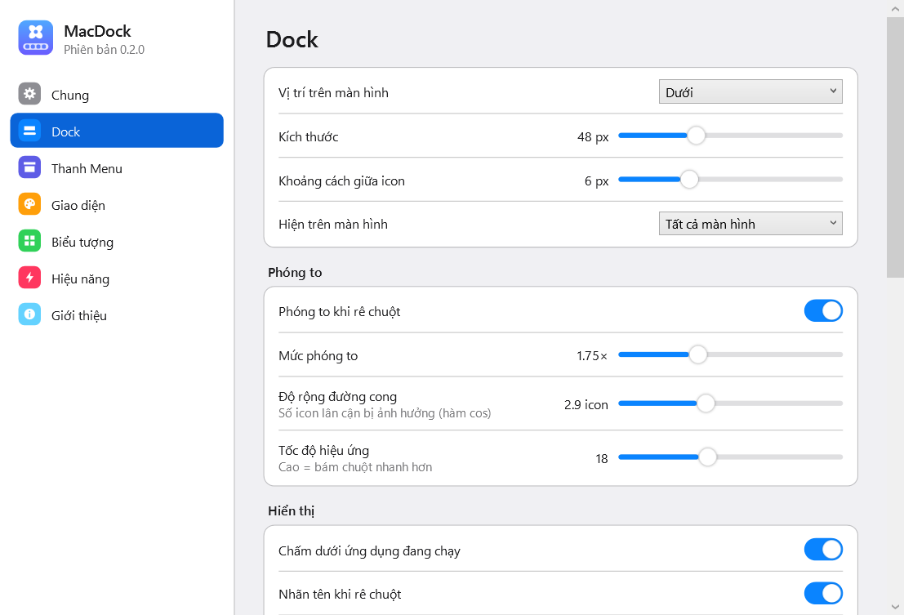
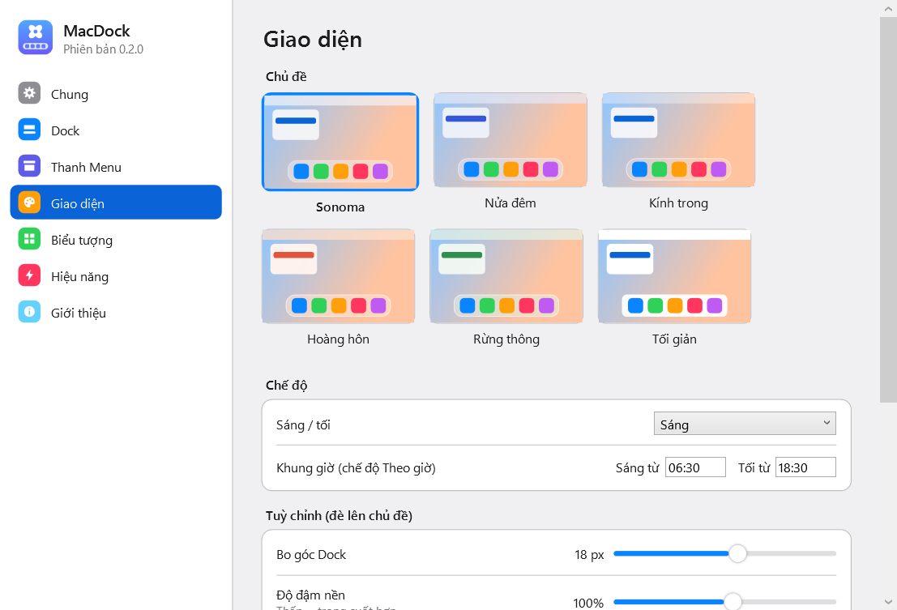
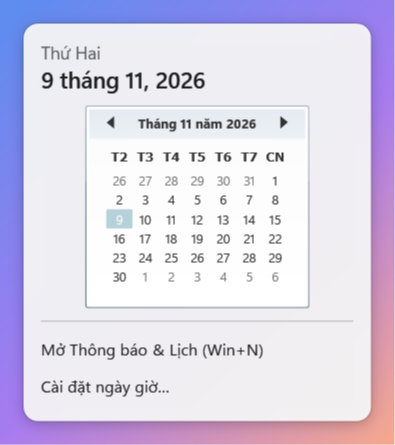

# MacDock

**Dock, Thanh Menu và theme kiểu macOS cho Windows 11** — viết bằng C# / .NET 8 / WPF.
Phần mềm gốc: không dùng logo, icon, phông chữ hay tài nguyên nào của Apple; mọi icon (logo, Launchpad,
Thùng rác, Wi-Fi, pin…) đều tự vẽ bằng vector.


| Phóng to khi rê chuột | Trung tâm điều khiển | Menu hệ thống |
|---|---|---|
|  |  |  |

| Cài đặt Dock | Chọn giao diện | Lịch |
|---|---|---|
|  |  |  |
*Ảnh chụp từ ứng dụng chạy thật trên Windows 11 (1920×1080, 125%).*

## Tính năng

### Dock
- Phóng to theo đường cong cos, làm mượt theo thời gian; chỉnh được kích thước, mức phóng to, độ rộng đường cong, tốc độ.
- Nảy khi mở ứng dụng, nảy khi ứng dụng cần chú ý; chấm dưới app đang chạy; nhãn tên; bóng đổ.
- Huy hiệu thông báo: chấm đỏ khi cửa sổ nhấp nháy, số khi tiêu đề có dạng `(3) Messenger`.
- Bấm icon: mở app / đưa lên trước / bấm lại để thu nhỏ / nhiều cửa sổ thì chuyển vòng.
- Chuột phải: danh sách cửa sổ, Mở cửa sổ mới, Giữ trên Dock, chuyển trái/phải, Hiện trong Explorer, đổi icon, Ẩn, Thoát, Buộc thoát.
- Kéo thả: sắp xếp icon, kéo ra ngoài để gỡ; kéo `.exe` / `.lnk` / thư mục vào để ghim; kéo file lên app để mở bằng app đó;
  kéo file vào Thùng rác để xoá (vào Thùng rác của Windows, có thể hoàn tác).
- Launchpad (mở Start) ở đầu, vạch ngăn + Thùng rác ở cuối.
- Xem trước cửa sổ khi rê chuột lên app đang chạy (ảnh thu nhỏ trực tiếp, bấm để chuyển, nút × để đóng).
- Thêm ứng dụng bằng cửa sổ chọn app đã cài (có tìm kiếm), hoặc kéo thả; quản lý danh sách ghim trong Cài đặt.
- Icon Launchpad chọn được: lưới màu, logo Windows 11 hoặc ảnh tự chọn.
- Vị trí dưới / trái / phải, tự động ẩn thông minh (chỉ ẩn khi có cửa sổ che Dock), chừa chỗ để cửa sổ phóng to không che Dock.
- Nhiều màn hình; tự ẩn khi có ứng dụng toàn màn hình (game, video).

### Thanh Menu
- Nền kính liquid (làm mờ thật hình nền, chỉnh được độ liquid), trong suốt, kính mờ, màu của Dock hoặc màu đặc; màu chữ tự chọn theo hình nền.
- Logo hình tròn (đổi được, kể cả ảnh tự chọn) mở menu hệ thống: Giới thiệu máy này, Cài đặt Windows, Cài đặt MacDock, Task Manager, Ngủ, Khởi động lại, Tắt máy, Khoá, Đăng xuất.
- Tên ứng dụng đang dùng (in đậm) và **menu thật** của ứng dụng: menu Win32 (`GetMenu`) hoặc UI Automation; nếu app không có thì dùng menu chung (Tệp, Sửa, Xem, Cửa sổ, Trợ giúp).
- Bên phải: **icon khay hệ thống** (Unikey/EVKey, Zalo, OneDrive, PowerToys… — bấm trái/phải/đúp đều hoạt động), bộ gõ/ngôn ngữ,
  pin, Wi-Fi (danh sách mạng, kết nối ngay trong popup), âm lượng (thanh trượt, lăn chuột), Trung tâm điều khiển (Wi-Fi, Bluetooth, độ sáng, âm lượng, chế độ tối),
  thông báo (Win+N), đồng hồ định dạng tuỳ chỉnh (bấm để mở lịch nhỏ).

### Âm lượng & độ sáng
- Bấm phím âm lượng/độ sáng hiện bảng kính kiểu macOS 26 thay cho bảng của Windows (chọn được trong Cài đặt).

### Cài đặt, theme, hệ thống
- Giao diện Tiếng Việt / English (chọn trong Cài đặt → Chung).
- Cửa sổ Cài đặt kiểu System Settings, xem trước trực tiếp, khôi phục mặc định từng trang hoặc toàn bộ.
- Trang Hiệu năng: giới hạn FPS, tắt hiệu ứng, giảm hiệu ứng khi dùng pin, đo RAM/CPU trực tiếp.
- Theme engine (`theme.json`): màu sáng/tối, độ trong suốt, gradient, kính Acrylic cho Thanh Menu, viền, bo góc, bóng, phông chữ;
  chế độ Sáng / Tối / Theo Windows / Theo giờ; icon gốc hoặc squircle; đổi icon từng app; icon pack;
  nhập/xuất gói `.macdocktheme` (zip). 6 theme dựng sẵn: Ánh sáng, Nửa đêm, Kính trong, Hoàng hôn, Rừng thông, Tối giản.
  Đổi nhanh từ menu chuột phải của Dock.
- Tự khởi động cùng Windows (bật mặc định), màn hình chào lần đầu, chỉ một tiến trình (chạy lại → mở Cài đặt).
- "Giới thiệu máy này" và màn hình chào kiểu macOS 26.
- Tự chuyển cấu hình từ MacDock 0.1.

## Cài đặt

1. Tải `MacDock-win-x64.zip` ở mục [**Releases**](https://github.com/Vudinhdat02/appThemeMacOS/releases) (hoặc artifact của GitHub Actions), giải nén vào thư mục bất kỳ,
   ví dụ `%LOCALAPPDATA%\Programs\MacDock`.
2. Chạy `MacDock.exe`. Bản phát hành đã kèm .NET, không cần cài thêm gì.
3. Ở màn hình chào chọn các tuỳ chọn rồi bấm **Bắt đầu**.

Dữ liệu và cấu hình nằm ở `%APPDATA%\MacDock` (`config.json`, `themes\`, `icons\`, `macdock.log`).

## Khôi phục taskbar Windows

MacDock lưu trạng thái taskbar gốc trước khi ẩn và **luôn khôi phục** khi thoát, khi gặp lỗi, khi đăng xuất/tắt máy.
Nếu MacDock bị tắt đột ngột, tiến trình canh chừng (watchdog) sẽ khôi phục; nếu cả hai bị tắt cùng lúc thì lần chạy sau sẽ khôi phục.
Bất cứ lúc nào cũng có thể khôi phục bằng tay:

```bash
MacDock.exe --restore-taskbar
```

Hoặc trong Cài đặt → Chung → tắt **Ẩn thanh tác vụ của Windows** (phương án dự phòng: giữ taskbar gốc, Dock nằm phía trên nó).

## Build từ mã nguồn

Cần Windows 10/11 và .NET 8 SDK (hoặc mới hơn).

```bash
git clone https://github.com/Vudinhdat02/appThemeMacOS.git
```

```bash
dotnet build src/MacDock/MacDock.csproj -c Release
```

Tạo file chạy đơn (self-contained, win-x64) vào thư mục `dist`:

```bash
dotnet publish src/MacDock/MacDock.csproj -c Release -r win-x64 --self-contained true -p:PublishSingleFile=true -p:PublishReadyToRun=true -o dist
```

GitHub Actions (`.github/workflows/build.yml`) tự build mỗi lần push và tạo Release kèm file zip khi đẩy tag `v*`.
Icon ứng dụng được vẽ bằng script `tools/make-icon.ps1`.

## Hiệu năng (đo thật)

Máy thử: Intel Core i7-9750H, Windows 11, 1920×1080 @125%, bản Release single-file.

| Chỉ số | Kết quả |
|---|---|
| RAM (working set) tiến trình chính khi rảnh | ~50–80 MB |
| RAM tiến trình watchdog | ~10 MB |
| Tổng | ~60–90 MB |
| CPU khi rảnh (không ai đụng vào máy) | ~0% — không vẽ lại khung hình nào |
| CPU khi người dùng đang làm việc ở app khác | ~0,15–0,3% (trung bình 60 giây, tính trên toàn CPU) |

Dock chỉ vẽ khi đang rê chuột hoặc đang có hiệu ứng; cửa sổ được theo dõi bằng shell hook / `SetWinEventHook`
thay vì quét liên tục.

## Giới hạn đã biết

- Huy hiệu số chỉ lấy được từ tiêu đề cửa sổ (`(3) ...`) hoặc trạng thái nhấp nháy; Windows không cho đọc huy hiệu
  thông báo của taskbar / app Store.
- Menu thật của app: chỉ app có menu Win32 hoặc thanh menu lộ qua UI Automation. App vẽ menu riêng (nhiều app Electron,
  Chrome, Explorer mới) sẽ dùng menu chung.
- Các icon hệ thống do Explorer tự vẽ (âm lượng, mạng, pin) không đi qua khay hệ thống; MacDock thay bằng chỉ báo riêng.
  Icon pin trùng của Explorer được ẩn mặc định.
- Kính Acrylic chỉ dùng cho Thanh Menu; Dock dùng hiệu ứng kính giả lập (gradient + viền sáng) để tránh làm mờ cả vùng
  trong suốt quanh Dock.
- Đã kiểm thử trên một màn hình; mã hỗ trợ nhiều màn hình và DPI khác nhau nhưng chưa thử trên máy nhiều màn hình thật.
- Ứng dụng chạy với quyền admin có thể không nhận được thao tác từ MacDock (giới hạn UIPI của Windows) nếu MacDock chạy quyền thường.
- Phím độ sáng do phần cứng xử lý: MacDock hiện bảng của mình nhưng Windows có thể vẫn hiện bảng mặc định.
- Chưa có: Launchpad toàn màn hình, Spotlight, góc nóng (dự kiến bản sau). Không làm nút cửa sổ đỏ/vàng/xanh.

## Giấy phép

[MIT](LICENSE). Xem thêm [đặc tả tính năng](docs/dac-ta-tinh-nang.md) và [nhật ký thay đổi](CHANGELOG.md).
