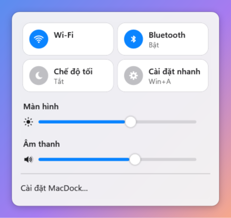
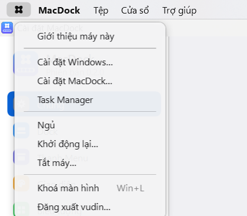
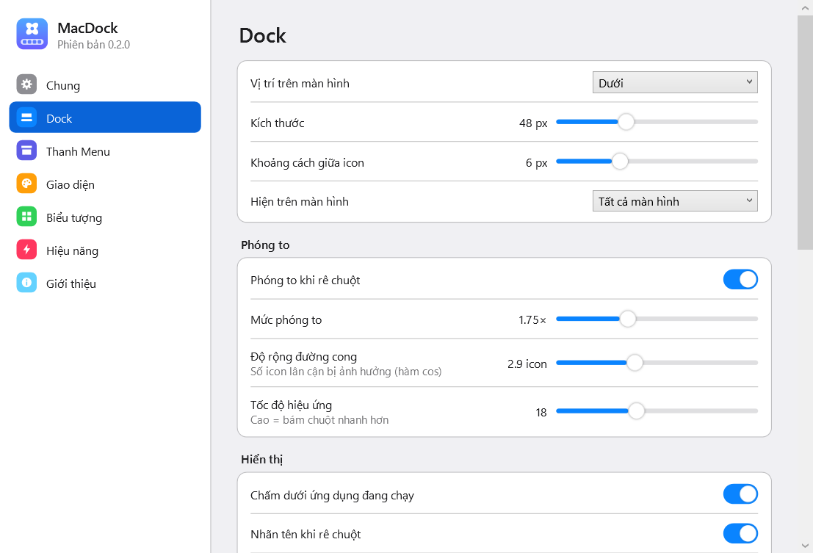
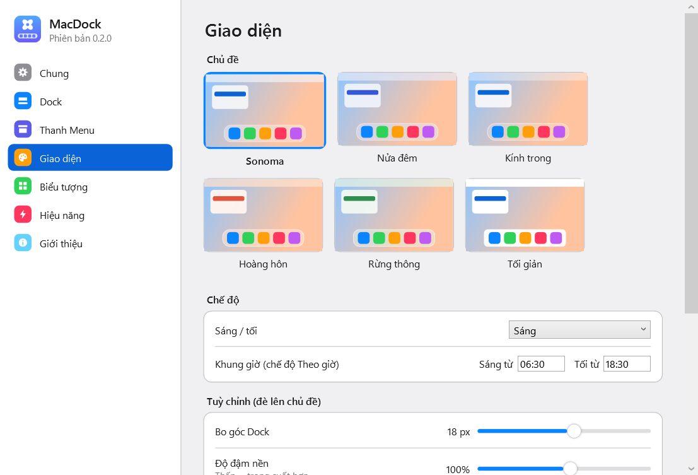
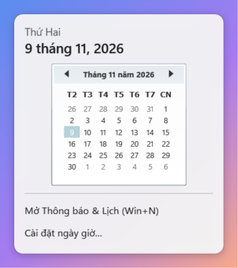

# MacDock

[English](README.md) · **Tiếng Việt** · [Hướng dẫn cài đặt & sử dụng](GUIDE.md#tiếng-việt)

**Dock, Thanh Menu và theme lấy cảm hứng từ macOS cho Windows 11** — viết bằng C# / .NET 8 / WPF.
Phần mềm gốc: không dùng logo, icon, phông chữ hay tài nguyên nào của Apple; mọi icon (logo, Launchpad,
Thùng rác, Wi-Fi, pin…) đều tự vẽ bằng vector.


| Phóng to khi rê chuột | Trung tâm điều khiển | Menu hệ thống |
|---|---|---|
|  |  |  |

| Cài đặt Dock | Chọn giao diện | Lịch |
|---|---|---|
|  |  |  |

## Tính năng

### Dock
- Phóng to theo đường cong cos, làm mượt theo thời gian; chỉnh được kích thước, mức phóng to, độ rộng đường cong, tốc độ.
- Nảy khi mở ứng dụng hoặc khi ứng dụng cần chú ý; chấm dưới app đang chạy; nhãn tên; bóng đổ.
- Huy hiệu: chấm đỏ khi cửa sổ nhấp nháy, số khi tiêu đề có dạng `(3) Messenger`.
- Bấm icon: mở app / đưa lên trước / bấm lại để thu nhỏ / nhiều cửa sổ thì chuyển vòng.
- Xem trước cửa sổ khi rê chuột lên app đang chạy (ảnh thu nhỏ trực tiếp, bấm để chuyển, nút × để đóng).
- Chuột phải: danh sách cửa sổ, Mở cửa sổ mới, Giữ trên Dock, chuyển trái/phải, Hiện trong Explorer, Đổi biểu tượng, Ẩn, Thoát, Buộc thoát.
- Kéo thả: sắp xếp icon, kéo ra ngoài để gỡ; thả `.exe` / `.lnk` / thư mục để ghim; thả file lên app để mở bằng app đó;
  thả file vào Thùng rác để xoá (vào Thùng rác của Windows, có thể hoàn tác).
- Thêm ứng dụng từ danh sách mọi app đã cài (kể cả app Store) có ô tìm kiếm; quản lý danh sách ghim trong Cài đặt.
- Vị trí dưới / trái / phải; tự ẩn thông minh (chỉ ẩn khi có cửa sổ che Dock, hiện ngay khi chuột chạm mép màn hình);
  chừa chỗ để cửa sổ phóng to không che Dock.
- Nhiều màn hình; tự ẩn khi có ứng dụng toàn màn hình (game, video).

### Thanh Menu
- Nền kính liquid (làm mờ thật hình nền, chỉnh được độ liquid), trong suốt, kính mờ, màu của Dock hoặc màu đặc;
  màu chữ tự chọn theo hình nền.
- Logo hình tròn (đổi được, kể cả ảnh tự chọn) mở menu hệ thống: Giới thiệu máy này, Cài đặt Windows, Cài đặt MacDock,
  Task Manager, Ngủ, Khởi động lại, Tắt máy, Khoá, Đăng xuất.
- Tên ứng dụng đang dùng (in đậm) và **menu thật** của ứng dụng (menu Win32 hoặc UI Automation), không có thì dùng menu chung.
- Bên phải: **icon khay hệ thống** (Unikey/EVKey, Zalo, OneDrive, PowerToys… — bấm trái/phải/đúp đều hoạt động), bộ gõ,
  pin, Wi-Fi (danh sách mạng, kết nối ngay trong popup), âm lượng, Trung tâm điều khiển (Wi-Fi, Bluetooth, độ sáng,
  âm lượng, chế độ tối), thông báo (Win+N), đồng hồ tuỳ định dạng kèm lịch nhỏ.

### Khác
- Bảng âm lượng/độ sáng dạng kính khi bấm phím trên bàn phím (hoặc giữ bảng của Windows).
- Win+Space đổi bộ gõ được cả khi taskbar Windows đang ẩn.
- Giao diện Tiếng Việt / English.
- Cửa sổ Cài đặt kiểu System Settings, xem trước trực tiếp, khôi phục mặc định từng trang; trang Hiệu năng
  (giới hạn FPS, tắt hiệu ứng, giảm khi dùng pin, đo RAM/CPU).
- Theme engine (`theme.json`): màu sáng/tối, độ trong suốt, gradient, viền, bo góc, bóng, phông chữ; chế độ Sáng / Tối /
  Theo Windows / Theo giờ; icon gốc hoặc squircle; đổi icon từng app; icon pack; nhập/xuất `.macdocktheme`. 6 theme dựng sẵn.
- Khởi động cùng Windows ngay khi đăng nhập qua Task Scheduler (không bị trì hoãn), chỉ một tiến trình, màn hình chào.

## Cài đặt

Xem **[hướng dẫn cài đặt & sử dụng](GUIDE.md#tiếng-việt)** đầy đủ. Tóm tắt:

1. Tải `MacDock-win-x64.zip` ở mục [**Releases**](https://github.com/Vudinhdat02/appThemeMacOS/releases).
2. Giải nén vào một thư mục cố định, ví dụ `%LOCALAPPDATA%\Programs\MacDock`.
3. Chạy `MacDock.exe` (đã kèm .NET). Chọn tuỳ chọn ở màn hình chào.

Không cần chỉnh gì trong Windows. Yêu cầu: Windows 11 (hoặc Windows 10 1903 trở lên), 64-bit.

## Khôi phục taskbar Windows

MacDock lưu trạng thái taskbar gốc trước khi ẩn và **luôn khôi phục** khi thoát, gặp lỗi, đăng xuất hoặc tắt máy.
Tiến trình canh chừng (watchdog) sẽ khôi phục nếu MacDock bị tắt đột ngột. Bất cứ lúc nào cũng có thể chạy:

```bash
MacDock.exe --restore-taskbar
```

Hoặc tắt **Ẩn thanh tác vụ của Windows** trong Cài đặt → Chung (giữ taskbar gốc, Dock nằm phía trên nó).

## Build từ mã nguồn

Cần Windows 10/11 và .NET 8 SDK (hoặc mới hơn).

```bash
git clone https://github.com/Vudinhdat02/appThemeMacOS.git
```

```bash
dotnet publish src/MacDock/MacDock.csproj -c Release -r win-x64 --self-contained true -p:PublishSingleFile=true -p:PublishReadyToRun=true -o dist
```

GitHub Actions (`.github/workflows/build.yml`) tự build mỗi lần push và tạo Release kèm file zip khi đẩy tag `v*`.

## Hiệu năng (đo thật)

Intel Core i7-9750H, Windows 11, 1920×1080 @125%, bản Release single-file.

| Chỉ số | Kết quả |
|---|---|
| RAM tiến trình chính khi rảnh | ~45–80 MB |
| RAM tiến trình watchdog | ~10 MB |
| CPU khi rảnh | ~0% — không vẽ lại khung hình nào |
| CPU khi đang làm việc ở app khác | ~0,1–0,3% |

## Giới hạn đã biết

- Huy hiệu số chỉ lấy từ tiêu đề cửa sổ hoặc cửa sổ nhấp nháy; Windows không cho đọc huy hiệu của taskbar/app Store.
- Menu thật chỉ có với app dùng menu Win32 hoặc lộ thanh menu qua UI Automation; app khác dùng menu chung.
- Phím độ sáng do phần cứng xử lý nên Windows có thể vẫn hiện bảng của nó.
- Đã kiểm thử trên Windows 11 với một màn hình; máy nhiều màn hình và máy ARM chưa thử.
- File chạy chưa có chữ ký số nên SmartScreen có thể cảnh báo lần đầu; một số phần mềm diệt virus có thể cảnh báo vì hook bàn phím.
- Chưa có: Launchpad toàn màn hình, tìm kiếm, góc nóng.

## Giấy phép

[MIT](LICENSE). Xem thêm [nhật ký thay đổi](CHANGELOG.md) và [đặc tả tính năng](docs/dac-ta-tinh-nang.md).

Nhà phát triển: **Vũ Đình Đạt** — [GitHub](https://github.com/Vudinhdat02) · [Website](https://vudinhdat02.github.io/)
